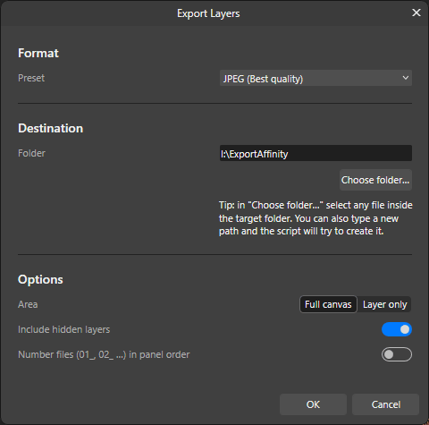
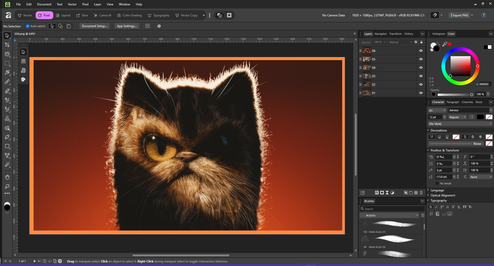

# Export Layers

Exports each layer of the document as a separate JPG or PNG file, named after its name in the Layers panel. You can choose the export preset, the destination folder, whether to export at full canvas size or cropped to the layer, and whether to include hidden layers.

## Requirements

- **Affinity by Canva** with scripting support (Script Editor and Scripts Library).
- **Settings > Scripting > Enable Affinity Scripting** turned on.
- **Access the file system** turned on for this script (gear icon next to **Run** in the Script Editor). New scripts inherit the defaults from **Settings > Scripting > Default Permissions**.
- The destination folder must be inside a folder listed in **Settings > Scripting > File System access**. Use **Add** to allow a new folder.

## Installation

1. Open the **Script Editor** panel and click **New Script**.
2. Paste the contents of [`export-layers.js`](export-layers.js).
3. Click **Save As…** to add it to the **Scripts Library**.

## Usage

1. Open the document whose layers you want to export. Each top-level layer becomes one file, using its name from the Layers panel:

   

2. Run the script from the Scripts Library (or click **Run** in the Script Editor).
3. Set the options in the dialog and click **OK**.

| Option | Description |
| --- | --- |
| Preset | Any JPEG or PNG export preset installed in Affinity. Defaults to *JPEG (Best quality)*. |
| Folder | Destination folder. Defaults to the first allowed folder. Type a path or use **Choose folder…** (pick any file inside the target folder). |
| Area | *Full canvas*: every file has the document's size. *Layer only*: cropped to the layer's bounds. |
| Include hidden layers | Also exports layers that are currently hidden. |
| Number files | Prefixes files with `01_`, `02_`… following the Layers panel order. |

When it finishes, the script restores every layer's original visibility and shows a summary.

## Behavior and limitations

- Only **top-level layers** are exported; layers inside a group are exported as part of that group.
- Characters that Windows does not allow in file names are replaced with `_`. Duplicate names get a `_2`, `_3`… suffix.
- The script hides and shows layers while exporting, which adds steps to the **History** panel. The document itself is not changed.
- Creating a new folder from the script may not work in every environment. If the export fails, create the folder first in your file manager.
- There is no native folder picker in the scripting SDK, so **Choose folder…** uses the file picker and takes the selected file's folder.

## Troubleshooting

Open **Running Scripts > View Log**. The script logs its permissions and allowed folders at startup.

| Error | Cause / fix |
| --- | --- |
| `PERMISSION_DENIED` | File system access is off for this script. Enable it with the gear icon next to **Run**. |
| `NO_ENVIRONMENT` | The folder could not be created. Create it manually and run again. |
| Folder not allowed | Add the folder in **Settings > Scripting > File System access**. |

## Tested with

Affinity by Canva on Windows 11 (October 2026).
